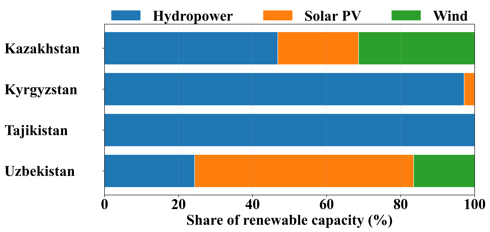

# Figure 1 - Installed renewable capacity mix by technology in Central Asia, 2025

Reproducible code and input data for **Figure 1**, showing the technology mix of
installed renewable electricity capacity in Kazakhstan, Kyrgyzstan, Tajikistan
and Uzbekistan in 2025.



## Repository contents

```text
central-asia-renewable-capacity-2025/
|-- plot_capacity_mix.py          # Data preparation and plotting
|-- requirements.txt            # Versions used for verification
|-- README.md
|-- data/
|   |-- irena_capacity_2025.csv   # 12 input observations; capacity in MW
|   `-- README.md                # Provenance, fields and missing values
`-- figures/
    |-- figure_01_capacity_mix_2025.png
    |-- figure_01_capacity_mix_2025.pdf
    `-- figure_01_capacity_mix_2025_large_font.png
```

## Reproduce the figure

Verified with **Python 3.13.1**, pandas 3.0.3, NumPy 2.4.6 and Matplotlib 3.10.9.
Run the following commands from the repository directory:

```bash
python -m venv .venv
```

Activate the environment:

- Windows PowerShell: `.\.venv\Scripts\Activate.ps1`
- macOS / Linux: `source .venv/bin/activate`

Then install the dependencies and run the script:

```bash
python -m pip install -r requirements.txt
python plot_capacity_mix.py
```

On Windows, `py -3.13` can be used instead of `python` to select Python 3.13.
The script resolves paths relative to its own location. Outputs are saved in
`figures/` and overwritten on subsequent runs.

The original styling uses **Times New Roman**. Install this font to reproduce
the typography; otherwise Matplotlib uses an available fallback font.
PNG files are saved at 300 dpi. The standard figure is also exported as PDF;
the alternate PNG uses font size 30 instead of 25.

## Data and calculation

The supplied CSV is a subset of the original IRENASTAT **C-ELECCAP** export
`C-ELECCAP_20260908-055900.csv`. It contains four countries, the year 2025,
the `OnGrid` grid connection, and three non-overlapping technology categories:

| Source technology | Figure label |
| --- | --- |
| Renewable hydropower | Hydropower |
| Solar photovoltaic | Solar PV |
| Onshore wind energy | Wind |

All preprocessing is in `plot_capacity_mix.py`:

1. Read the supplied CSV and convert capacity values to numbers.
2. Select the year, countries and technologies listed above.
3. Sum capacity by country and technology and fill missing components with zero.
4. Divide each component by the sum of the three selected components for its country.
5. Multiply by 100 and draw a horizontal stacked bar chart.

```text
share (%) = technology capacity (MW)
            / [hydropower + solar PV + onshore wind capacity (MW)] * 100
```

**Interpretation:** the bars show the composition of the three selected
renewable technologies. Bioenergy and other technologies are excluded from the
denominator. These percentages are not renewable shares of total electricity
capacity or electricity generation.

The source contains `-` for onshore wind in Kyrgyzstan and Tajikistan. The
original plotting logic converts these entries to missing values and then
uses zero in the chart. This reproduces the original calculation; it does
not independently establish that the underlying capacity is zero.

See [data documentation](data/README.md) for field definitions and provenance.

## Scope and verification

This repository reproduces Figure 1 only and does not download data or access
external services.
The extracted data and plotting calculations were checked against the original
project: both standard and large-font versions retain the same bar positions,
segment widths and country labels. Generated outputs are included so reviewers
can inspect the figure without installing Python.
